


 

 



 


<a href="https://github.com/mabubakar4321/VandoraX-Multi-Vendor-E-Commerce-Application-">
  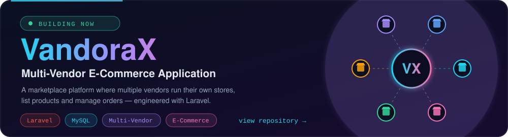
</a>

 


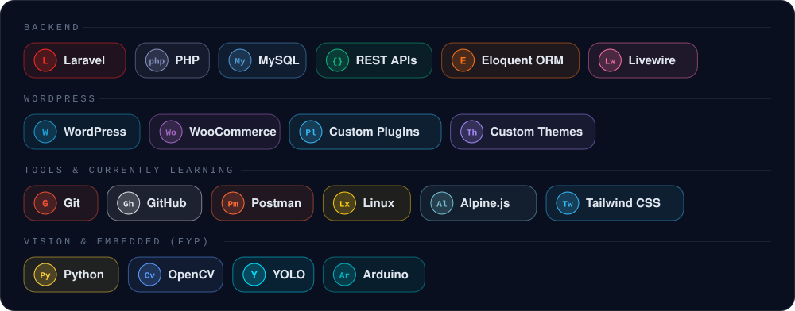
  

 


<!-- TODO: replace the link below with your FYP repository URL -->
<a href="https://github.com/mabubakar4321?tab=repositories">
  
</a>

 

An automated sorting prototype that identifies items on a moving conveyor with a camera and computer vision, then routes each one into the correct box using Arduino-controlled gates and sensors.

| | |
|:--|:--|
| **🧠 Vision** | Real-time detection and classification (YOLO / OpenCV) with a confidence threshold and an *Unknown / Reject* class |
| **🔌 Embedded control** | Arduino Mega reads 4 IR sensors, opens only the target gate, then closes it after the item drops |
| **📡 Communication** | Laptop ↔ Arduino USB serial protocol (target gate + acknowledgements) |
| **📊 Dashboard** | Live camera feed, class → box mapping, sorting logs, counters and CSV export |
| **🎯 Targets** | ≥ 90% detection accuracy · ≥ 95% sorting success · 10–20 items/min |

 

<table>
  <tr>
    <td><a href="https://github.com/mabubakar4321/Smart-Restaurant-Reservation-System---Laravel-10"></a></td>
    <td><a href="https://github.com/mabubakar4321/Advanced-Laravel-11-E-Commerce-Platform-with-Breeze-PDF-Invoicing-Bootstrap-UI"></a></td>
  </tr>
  <tr>
    <td><a href="https://github.com/mabubakar4321/-Library-Management-System-Laravel-12-Jetstream-Bootstrap"></a></td>
    <td><a href="https://github.com/mabubakar4321/QuizMaster-Laravel"></a></td>
  </tr>
  <tr>
    <td><a href="https://github.com/mabubakar4321/Student-Management-System-laravel"></a></td>
    <td><a href="https://github.com/mabubakar4321?tab=repositories"></a></td>
  </tr>
</table>

 


 

<picture>
  <source media="(prefers-color-scheme: dark)" srcset="https://raw.githubusercontent.com/mabubakar4321/mabubakar4321/output/github-snake-dark.svg" />
  <source media="(prefers-color-scheme: light)" srcset="https://raw.githubusercontent.com/mabubakar4321/mabubakar4321/output/github-snake.svg" />
  
</picture>

 



 

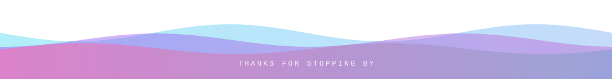

